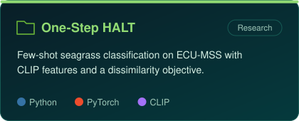

  

  
  
  
  

 

## About

I'm a master's student in **Data Science** at **Shimane University, Japan**, researching **few-shot image classification** — models that generalize from only a handful of labeled examples.

My current work applies **CLIP (ViT-B/32)** embeddings and **Prototypical Networks** to **seagrass species recognition**, and explores **teacher–student self-training** with pseudo-labels to learn from unlabeled data.

 

## Selected work

  
  

  

 

## Publications

> **One-Step HALT with Dissimilarity for Few-Shot Seagrass Classification** 
> M. W. Ahmad, *et al.* — manuscript under revision · [code](https://github.com/WazirAhmadMatin/One-Step-HALT-with-Dissimilarity)

 

## Toolkit

  

 

## Education

| | | |
|:--|:--|--:|
| **M.Sc. Data Science** · Intelligent Information Design | Shimane University, Japan | 2025 – present |
| **B.Sc. Computer Science** · Software Engineering | Herat University | 2017 – 2021 |

 

## Activity

  

  
  

