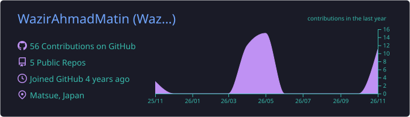
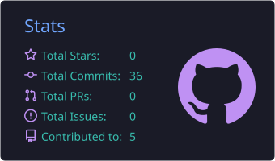
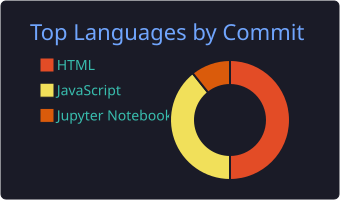

<!-- ===================== HEADER ===================== -->

  
  
  

<!-- ===================== ABOUT ===================== -->
## 👨‍💻 About

I'm a **Data Science master's student at Shimane University** (Graduate School of Natural Science and Technology), working on **few-shot image classification** — building models that perform well when only a handful of labeled examples exist.

My research applies **CLIP (ViT-B/32)** and **Prototypical Networks** to **seagrass species recognition**, and explores **teacher–student self-training** with pseudo-labels to make the most of unlabeled data.

<table>
<tr>
<td valign="top" width="50%">

**🔬 Research interests**
- Few-shot & meta-learning
- Vision-language models (CLIP)
- Semi-supervised / self-training
- Applied computer vision for ecology

</td>
<td valign="top" width="50%">

**📌 Currently**
- 📝 Revising a paper on One-Step HALT for few-shot seagrass classification
- 🧪 Experimenting with ProtoNet teacher–student pipelines
- 🇯🇵 Studying Japanese (JLPT N4)

</td>
</tr>
</table>

<!-- ===================== PROJECTS ===================== -->
## 🚀 Featured work

<table>
<tr>
<td width="33%" valign="top">

### [One-Step HALT](https://github.com/WazirAhmadMatin/One-Step-HALT-with-Dissimilarity)
Few-shot seagrass classification on **ECU-MSS** using CLIP features with a dissimilarity-based objective.

</td>
<td width="33%" valign="top">

### [nihongo-app](https://github.com/WazirAhmadMatin/nihongo-app)
A web app for practicing Japanese vocabulary and grammar for the JLPT.

</td>
<td width="33%" valign="top">

### [chair-sus-survey](https://github.com/WazirAhmadMatin/chair-sus-survey)
A usability-testing survey built on the **System Usability Scale (SUS)**.

</td>
</tr>
</table>

<!-- ===================== STACK ===================== -->
## 🛠️ Tech stack

  

<!-- ===================== EDUCATION ===================== -->
## 🎓 Education

| Degree | Institution | Years |
|---|---|---|
| **MSc, Data Science** — Intelligent Information Design | Shimane University, Japan | 2025 – present |
| **BSc, Computer Science** — Software Engineering | Herat University | 2017 – 2021 |

<!-- ===================== STATS ===================== -->
## 📊 GitHub activity

  

  
  
  

  

<!-- ===================== FOOTER ===================== -->

