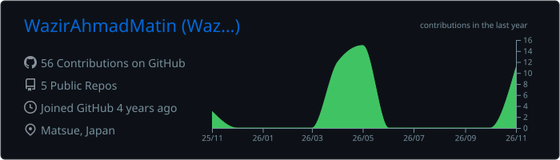
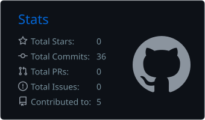
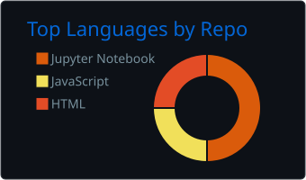
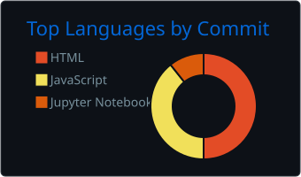

**Few-shot learning · Vision-language models · Semi-supervised computer vision**

---

### About

I am a master's student in **Data Science** at **Shimane University, Japan** (Graduate School of Natural Science and Technology, Intelligent Information Design course).

My research focuses on **few-shot image classification**: building models that generalize from only a handful of labeled examples. I currently work on **seagrass species recognition** using **CLIP (ViT-B/32)** embeddings and **Prototypical Networks**, and on **teacher–student self-training** that uses pseudo-labels to learn from unlabeled data.

### Research interests

`Few-shot & meta-learning` `Vision-language models` `Self-training / pseudo-labeling` `Computer vision for ecology`

### Publications

- **One-Step HALT with Dissimilarity for Few-Shot Seagrass Classification**
  M. W. Ahmad, et al. — *manuscript under revision*
  [[Code]](https://github.com/WazirAhmadMatin/One-Step-HALT-with-Dissimilarity)

### Selected projects

| Project | Summary | Stack |
|:--|:--|:--|
| [**One-Step HALT**](https://github.com/WazirAhmadMatin/One-Step-HALT-with-Dissimilarity) | Few-shot seagrass classification on ECU-MSS with CLIP features and a dissimilarity objective | Python · PyTorch · CLIP |
| [**nihongo-app**](https://github.com/WazirAhmadMatin/nihongo-app) | Web app for JLPT vocabulary and grammar practice | JavaScript · HTML · CSS |
| [**chair-sus-survey**](https://github.com/WazirAhmadMatin/chair-sus-survey) | Usability-testing survey based on the System Usability Scale (SUS) | HTML · JavaScript |

### Technical skills

| Area | Tools |
|:--|:--|
| Machine learning | PyTorch · scikit-learn · CLIP · NumPy · pandas |
| Programming | Python · JavaScript · HTML/CSS |
| Workflow | Git · Jupyter · Linux · VS Code |

### Education

| | | |
|:--|:--|:--|
| **M.Sc. Data Science** | Shimane University, Japan | 2025 – present |
| **B.Sc. Computer Science** (Software Engineering) | Herat University | 2017 – 2021 |

### Languages

English (professional) · Japanese (studying, JLPT N4 in progress)

---

<b>GitHub activity</b>

 

  

  
  
  

